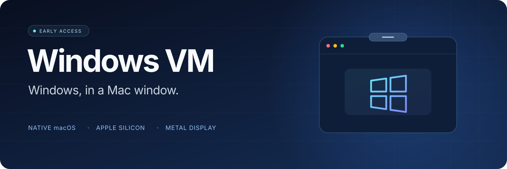
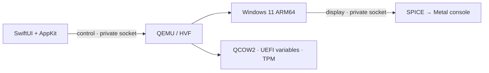

<div align="center">



# Windows VM

**A native Mac home for Windows 11.**

SwiftUI controls. Apple Silicon virtualisation. A Metal-powered display.

[](docs/INSTALLATION.md)
[](LICENSE)
[](https://github.com/DrSTEM/WindowsVM/actions/workflows/ci.yml)
[](docs/STATUS.md)

[Install](docs/INSTALLATION.md) · [Use](docs/USAGE.md) · [Update](docs/UPDATING.md) · [How it works](docs/ARCHITECTURE.md) · [Get help](docs/TROUBLESHOOTING.md)

</div>

Windows VM runs a real Windows 11 ARM64 guest inside a native macOS application. Create a machine, install Windows from Microsoft's ISO, and return to the same desktop next time. Your disk, firmware variables, and virtual TPM live together in one `.wvm` package.

> **Early access · build locally.** This repository includes source and an installer script. A signed, notarised app download is not available yet. Runtime binaries are fetched from official upstream sources on your Mac. See [release status](docs/STATUS.md) for verified behaviour and current limits.

## Get started

You need an **Apple Silicon Mac**, **Xcode 26 or newer** with its setup completed, and [Homebrew](https://brew.sh). Use a macOS version supported by both Xcode and Homebrew; macOS 15.6 or newer is the recommended starting point. Allow room for build dependencies and Windows. A Mac with 16 GB RAM and at least 100 GB free is recommended.

```bash
git clone https://github.com/DrSTEM/WindowsVM.git
cd WindowsVM
bash Install.command
```

The guided script checks prerequisites, installs missing Homebrew tools, downloads and authenticates the pinned UTM runtime, builds and tests the app, then installs it to `~/Applications/Windows VM.app`. It does not require an Apple Developer membership. You can also double-click `Install.command` in a Git checkout.

Next, [download Windows 11 ARM64 from Microsoft](https://www.microsoft.com/en-us/software-download/windows11arm64), open Windows VM, and choose **New**. Start with **4 CPUs · 6 GB RAM · 80 GB disk**, reducing resources if your Mac needs them. Windows licensing and activation are separate.

**First install?** Follow the [step-by-step guide](docs/INSTALLATION.md), including the network-driver step in Windows Setup.

## A small set of useful controls

| Everyday use | Included |
| --- | --- |
| Power | Start, pause, resume, graceful shutdown, confirmed reset and force stop |
| Display | SPICE with a Metal console, Retina-aware sizing, full screen, VNC compatibility |
| Input | Keyboard, pointer, scroll, optional relative mouse capture; **Control–Option** releases input |
| Storage | Persistent QCOW2 disks, expansion, disk import/export, whole-machine duplication |
| Installation | ARM64 ISO selection, live media mounting and ejecting, UEFI and virtual TPM 2.0 |
| Continuity | Keep a VM running when closing the app, then reconnect to its session |
| Graphics | Display-only modes plus experimental Direct3D 11 through DXMT |

Hover over the tab at the top centre of the console to reveal **VM Controls**. Open **Options** for media, power, capture, and display information. [Read the controls guide →](docs/USAGE.md)

## How it works



The interface is original Swift code. The engine uses QEMU with Apple's Hypervisor Framework. CocoaSpice handles the SPICE connection and Metal presentation; swtpm provides a persistent virtual TPM. The build uses selected components from a verified UTM release, rather than including the UTM app or its interface. [Architecture and source map →](docs/ARCHITECTURE.md)

## Updates and your data

After shutting down Windows and quitting the app:

```bash
cd WindowsVM
bash scripts/update.sh
```

The helper fast-forwards `main`, prepares the pinned dependencies, rebuilds, tests, and installs. The previous app is kept beside the new one. Back up your **whole `.wvm` package** while the guest is shut down, especially before an update. [Update, backup, and rollback guide →](docs/UPDATING.md)

## Know the limits

Apple Silicon and Windows ARM64 are the supported targets. Guest audio, clipboard/folder sharing, drag and drop, snapshots, nested virtualisation, and individual Windows app windows are not implemented. Output is SDR. Direct3D 11 is experimental; game compatibility and frame rates have not been established. The app is locally ad hoc signed and is not sandboxed. See [security](SECURITY.md) and [current status](docs/STATUS.md).

## Build, contribute, or report a problem

```bash
bash scripts/setup.sh
bash scripts/build-app.sh
bash scripts/test.sh
```

For Swift-only development after a full build, use `bash scripts/build-app.sh --frontend`. The guest can keep running when the bundled engine and runtime are unchanged. Normal installation and update helpers require a shutdown.

[Contributing](CONTRIBUTING.md) · [Report a bug](https://github.com/DrSTEM/WindowsVM/issues/new/choose) · [Third-party notices](ThirdParty/README.md) · [Changelog](CHANGELOG.md)

Original source is [MIT licensed](LICENSE). Dependencies retain their own licences. No Windows media, guest tools, VM disks, or prepared runtime binaries are committed here. Windows VM is an independent project, unaffiliated with Microsoft, Apple, UTM, or Parallels.
