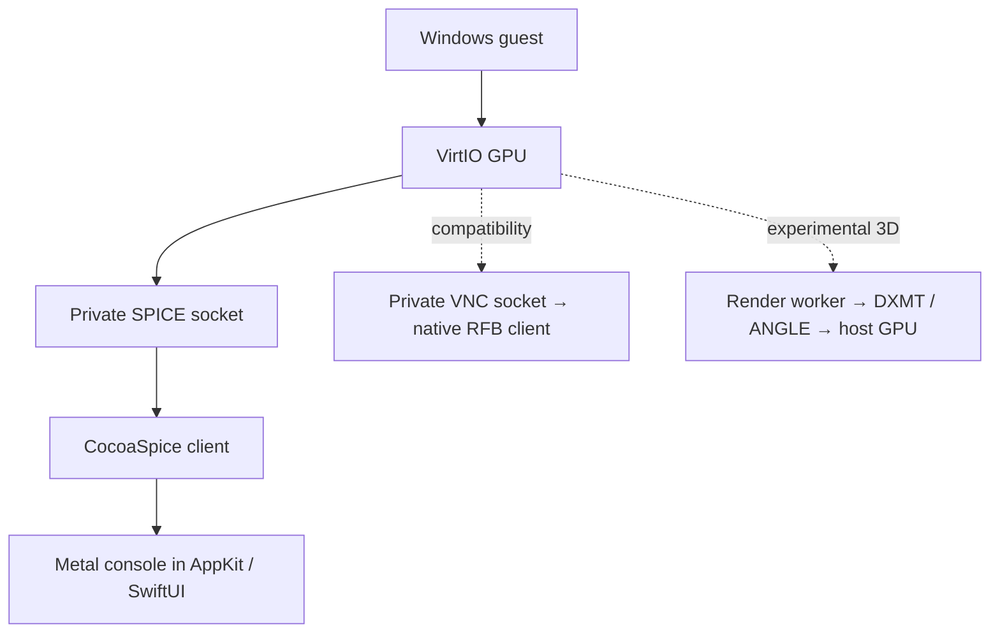

# How Windows VM works

[← Home](../README.md) · [Development](../CONTRIBUTING.md) · [Third-party components](../ThirdParty/README.md)

## From a button to a Windows desktop

The SwiftUI library creates a `.wvm` package and saves validated configuration. On Start, the controller creates a private session directory, launches swtpm with persistent state, then launches the entitled `VMEngine` helper. The helper loads UTM's QEMU ARM64 framework and calls its supported library entry points. QEMU uses Apple's Hypervisor Framework with an ARM64 `host` CPU; it does not silently fall back to CPU emulation.

QMP commands travel over a private Unix socket. The client checks the expected machine identity before control operations and serialises transactions. An unreachable control socket is treated conservatively: storage operations remain disabled until the app can establish that the guest stopped.

The guest sees an ARM virtual machine with UEFI firmware, persistent firmware variables, virtual TPM 2.0, NVMe storage backed by QCOW2, USB keyboard/tablet/mouse devices, and optional VirtIO networking through user-mode NAT.

## Display paths

SPICE display-only and 3D modes both use a Metal console on the Mac. This distinction matters: Metal presentation alone does not give Windows accelerated 3D. The experimental path additionally exposes a VirtIO 3D device, uses the compatible guest driver, and forwards Direct3D 11 work to DXMT through the rendering worker. The host and driver paths are adapted from the pinned UTM runtime.

The VNC fallback keeps legacy session compatibility. It merges pending display tiles and sends guest input off the UI thread. The SPICE renderer avoids presenting unchanged frames and suspends presentation for an occluded window. Neither path's refresh target is a measured gameplay frame rate.

## Persistent data

| Location | Purpose |
| --- | --- |
| `~/Library/Application Support/Windows VM/Machines/*.wvm/` | Default VM library |
| `config.json` inside a package | Versioned resource and device configuration |
| `disk.qcow2` | Windows system disk |
| `efi-vars.qcow2` | Persistent UEFI variables |
| `tpm/` | Persistent virtual TPM state |
| `session.json` | Running-session identity and private socket location for reconnection |
| `graphics-cache/` | Per-VM graphics caches when using experimental 3D |
| `qemu.log`, `serial.log` | Runtime and firmware diagnostics |
| `/private/tmp/wvm-<uid>-<uuid>/` | Private live-session sockets |

The library path can be selected and remembered with `open -a "Windows VM" --args --library "/absolute/path"`. This is a developer option, not a disk migration tool. Shut down guests before moving packages. Exporting a disk alone is different from preserving an entire machine.

## Source map

| File | Responsibility |
| --- | --- |
| `Sources/WindowsVM/WindowsVMApp.swift` | App entry point, library interface, create/settings flows |
| `Sources/WindowsVM/VMConsoleScreen.swift` | Console window and floating controls |
| `Sources/WindowsVM/ConsoleView.swift` | Console model and compatibility rendering/input |
| `Sources/WindowsVM/SpiceConsoleView.swift` | Embedded SPICE / Metal display and input |
| `Sources/WindowsVM/DisplaySupport.swift` | Resolution, scaling, colour/display helpers, frame buffering |
| `Sources/WindowsVM/VMController.swift` | VM lifecycle, persistence, library operations |
| `Sources/WindowsVM/VMConfiguration.swift` | Configuration validation, runtime paths, QEMU arguments |
| `Sources/WindowsVM/QMPClient.swift` | Machine control protocol |
| `Sources/WindowsVM/RFBClient.swift` | Compatibility VNC protocol |
| `Sources/WindowsVM/StorageManager.swift` | Disk creation, inspection, conversion, growth |
| `scripts/runtime-probe.c` | Small out-of-process QEMU library launcher |
| `scripts/build-spice.py` | Pinned CocoaSpice extraction, documented adaptations, compilation |
| `scripts/runtime-lock.json` | UTM download digest, identity, version, CocoaSpice revision |

## Dependency preparation

`setup.sh` checks prerequisites and ensures Homebrew tools exist. `setup-runtime.py` authenticates the pinned DMG and stages a replacement runtime. `prepare-runtime.py` checks the upstream app signature, signing team, notarisation assessment, and version, then copies the selected framework dependency closure, firmware, and rendering worker. It copies `qemu-img` and `swtpm` with their Homebrew dylib closure, rewrites paths, and locally signs the modified tools.

`build-spice.py` fetches an exact Git revision, extracts its immutable tree, applies the small source adaptations recorded in the script, and builds the Objective-C client/renderer. `build-app.sh` links the Swift frontend and packages runtime resources. It ad hoc signs the engine with the hypervisor entitlement and verifies the resulting bundle.

The runtime and generated app stay outside Git. Homebrew dependencies are resolved from the build machine, so the build is pinned at the UTM/CocoaSpice boundary rather than bit-for-bit reproducible. The repository does not include a full from-source UTM toolchain or cleared binary redistribution package.
